# Evidence-Gated Security Review for AI-Generated Software

**Research summary, market landscape, and prototype proposal**

**Audience:** software engineers, architects, and technology leadership

**Status:** internal discussion paper and working prototype
**Market snapshot:** 10 September 2026

---

## Executive summary

AI coding tools increase the rate at which teams can create and change software. They
do not remove the need for secure design, deterministic analysis, dependency control,
runtime testing, or accountable engineering review. The central organizational risk
is therefore not simply that an AI model may generate a vulnerable line of code. It is
that code-generation throughput can grow faster than the organization's ability to
understand, test, and accept the resulting risk.

Research provides reasons for caution, but not a timeless defect rate for all current
models. Earlier studies found insecure code generation and misplaced user confidence;
more recent work has found that LLMs can be unreliable when reasoning about complex
security data flows and can invent software package names. These results were obtained
with particular models, prompts, languages, and benchmarks, so they establish a class
of risk rather than a universal claim that AI-authored code is always less secure than
human-authored code.[^perry] [^llm-vuln] [^packages]

The proposed response is **Evidence-Gated Security Review**:

1. deterministic tools generate reproducible security hypotheses;
2. a scope gate creates the smallest permitted evidence packet;
3. one model explains and classifies a finding;
4. a different model attempts to refute the verdict;
5. code-enforced policy determines whether the evidence is promotable;
6. a human accepts, rejects, or escalates the resulting state;
7. an append-only record and a regression set measure whether the method works.

The repository containing this document is a prototype of that methodology. It is not
a replacement for a Secure Software Development Lifecycle (SSDLC), a penetration test,
or a commercial AppSec platform. Its intended role is a vendor-neutral evidence and
decision layer above SAST and, in future versions, SCA, secrets, IaC, container, and
dynamic-analysis tools.

The prototype demonstrates several strong controls: narrow data disclosure, strict
schemas, explicit model separation, human accountability, stable finding identity,
append-only decisions, and metrics. It is not production-complete. The current pilot
has limited scanner coverage, no configured golden set, no operational findings-store
integration, and insufficient observations to validate the accuracy of the two-model
method.

**Recommendation:** continue the prototype as a measured pilot; buy or adopt mature
detection engines rather than rebuilding them; use this project to normalize their
evidence and govern AI-assisted decisions; and automate only after the controls and
accuracy claims have been validated.

## 1. Problem statement

### 1.1 What changes when software is created with AI

The security properties required of software do not change based on authorship. An
authorization decision, cryptographic construction, dependency, or SQL query must meet
the same requirement whether it was written by a person, generated by a model, or
assembled by both.

What does change is the operating environment:

- **Generation velocity:** more code and more variants can be produced per engineer.
- **Review asymmetry:** generating a plausible implementation is faster than proving
  that it is secure.
- **Plausibility bias:** syntactically polished code and confident explanations can
  create more trust than the evidence supports.
- **Context loss:** a model may implement a local request without understanding system
  trust boundaries, ownership rules, or operational configuration.
- **Dependency uncertainty:** generated code may select unnecessary, outdated, or even
  nonexistent packages.
- **Repeated patterns:** one unsafe generation pattern can be replicated across many
  modules before it is recognized.
- **Mixed provenance:** most real repositories contain human-authored, generated, and
  heavily edited code; provenance is often incomplete and should not be treated as a
  dependable security boundary.

The last point matters strategically. A security process should not depend on reliably
detecting which individual lines were generated by AI. Sonar's market approach, for
example, applies a declared project label and stricter quality gate, while its previous
automatic AI-code detection is being deprecated.[^sonar] Evidence-Gated Security Review
similarly treats the selected repository or change set as the unit of assurance.

### 1.2 What the research does and does not establish

Three findings motivate the methodology:

- A controlled user study found that participants using an early AI coding assistant
  produced less secure solutions and were more likely to believe their solutions were
  secure.[^perry]
- A broad evaluation found that LLM security analysis was fragile under changes to
  prompts and code and struggled with complex data-flow reasoning.[^llm-vuln]
- A USENIX Security 2025 study generated 576,000 samples across 16 models and found
  persistent package hallucination, creating a potential package-confusion or
  "slopsquatting" attack path.[^packages]

These studies do **not** justify a fixed multiplier for AI-created risk, and they should
not be used to rank current models without new evaluation. Models, products, and
developer workflows change too quickly. The durable conclusion is narrower:

> Model output and model reasoning are hypotheses until independently checked against
> deterministic evidence, executable tests, or accountable human review.

## 2. Relationship to established security practice

Evidence-Gated Security Review is an implementation pattern inside an SSDLC, not a new
SSDLC framework.

- [NIST SSDF][nist-ssdf] supplies the lifecycle vocabulary: prepare the organization,
  protect software, produce well-secured software, and respond to vulnerabilities.
- [OWASP SAMM][owasp-samm] supplies a maturity model spanning governance, design,
  implementation, verification, and operations.
- [OWASP ASVS][owasp-asvs] supplies testable application-security requirements for
  architecture, authentication, session management, access control, validation,
  cryptography, data protection, APIs, and configuration.

The prototype concentrates on one difficult part of verification: turning a noisy
scanner candidate into a reviewable, attributable decision without granting an AI
agent broad repository or deployment authority.

It does not replace:

- threat modeling and security requirements;
- peer review and secure coding standards;
- software composition analysis and SBOM production;
- secret, IaC, and container scanning;
- unit, integration, abuse-case, and authorization tests;
- DAST, fuzzing, and runtime proof;
- penetration testing;
- vulnerability remediation and operational incident response.

## 3. Methodology principles

### 3.1 Deterministic detection before probabilistic judgment

Rule-based and query-based analyzers produce reproducible candidates. Models add
contextual reasoning, but they should not silently replace the detection record. Every
model conclusion must refer back to an immutable finding ID and concrete code evidence.

### 3.2 Evidence level is separate from confidence

The prototype recognizes three evidence levels:

| Evidence level | Meaning | Permitted conclusion |
|---|---|---|
| `traced` | The full attacker-controlled source-to-sink path was read | May support high confidence |
| `partial` | The sink and immediate callers were read, but the complete path was not established | Requires qualified confidence |
| `pattern` | The code matches a known-dangerous shape without a complete trace | Cannot alone establish a true positive |

This prevents a persuasive explanation from being mistaken for strong evidence.

### 3.3 Refutation is a separate task

The second pass does not summarize or improve the first. Its objective is to disprove
key claims by locating missing sanitizers, broken preconditions, unreachable paths,
scope gaps, or alternative interpretations.

Model diversity is a useful control, but not proof of independence. Different models
may share training sources, benchmark biases, or similar reasoning failures. A stronger
future design should first give the validator the raw packet without the first verdict,
compare the two independent classifications, and only then reveal the first verdict for
an explicit adversarial challenge.

### 3.4 A control refuses; it does not merely warn

Security-critical rules are implemented in code and fail closed:

- excluded paths cannot enter a packet;
- malformed schemas are not recorded;
- an invalid finding ID cannot steer an output path;
- the same declared model cannot perform both review passes;
- a challenge for an earlier verdict revision cannot be replayed;
- incomplete evidence cannot be promoted to a confident state;
- malformed audit history prevents further recording.

Prompt instructions support these controls but are not themselves the security
boundary.

### 3.5 Humans remain accountable for acceptance

The model recommends; the recorder applies policy; the human decides. A human decision
is explicitly recorded as `accepted`, `rejected`, or `escalated`. Model self-reported
identity is retained as history but does not control the process.

### 3.6 Automation follows demonstrated reliability

The first automation candidates are deterministic scanning, artifact generation,
findings import, and metrics. Repository-wide AI analysis, automatic fixes, or merge
blocking should follow only after representative evaluation shows acceptable coverage,
accuracy, failure behavior, data handling, and cost.

## 4. End-to-end workflow

```mermaid
flowchart LR
    A[Repository or change set] --> B[Deterministic scanners]
    B --> C[SARIF findings]
    C --> D[Scope and identity gate]
    D --> E[Minimal review packet]
    E --> F[Model A: triage]
    F --> G[Verdict schema and consistency checks]
    G --> H[Model B: independent challenge]
    H --> I[Challenge schema and revision binding]
    I --> J[Promotion policy]
    J --> K[Human decision]
    K --> L[Reviewed SARIF and audit log]
    L --> M[Remediation and retest]
    M --> N[Variant analysis and regression rule]
    N --> B
```



### Step 0: establish organizational authority

Confirm the approved AI account, retention and training settings, processing-residency
requirements, source-code classification, two distinct models, and human decision
owner. If external model processing is prohibited, retain the workflow but run the
reasoning stages on approved local infrastructure.

### Step 1: define the review context

Document attacker-controlled entry points, authenticated-but-untrusted inputs, trusted
configuration, security-critical modules, accepted patterns, severity policy, and
excluded paths. This context is project-specific and must be reviewed by an architect
or service owner.

### Step 2: curate and pin scanners

Pin tool and rule versions because scanner fingerprints contribute to finding identity.
Select rules for the actual language, framework, and threat model. A small actionable
queue is more useful for a pilot than a large generic ruleset whose alerts will not be
decided.

### Step 3: produce the deterministic evidence

Run scanners and retain their native artifact plus normalized SARIF. The scanner output
is a hypothesis, not a verdict.

### Step 4: build the review packet

Before reading source, resolve every path and apply exclusion policy. Include scanner
metadata, a narrow code window, short data-flow snippets, applicable policy, and a stable
finding ID. Do not include repository history, secrets, environment variables, or whole
files unless they are necessary and explicitly permitted.

### Step 5: perform model-assisted triage

Model A traces the input-to-sink path, records what was and was not established, and
returns structured JSON containing verdict, severity, confidence, evidence level,
preconditions, mitigating controls, related locations, and remediation guidance. It
must not claim to have executed code or reproduced an exploit in a static-only session.

### Step 6: perform independent validation

Model B runs in a fresh session on a different model and attempts to refute the verdict.
Its structured output records each claim tested, method, result, evidence, and an
overall `upheld`, `refuted`, or `inconclusive` decision. A digest binds the challenge to
the exact verdict revision.

### Step 7: apply promotion policy

The recorder validates both artifacts and computes one of the following states:

| State | Interpretation |
|---|---|
| `confirmed` | Evidence and required validation support a true positive |
| `dismissed` | Evidence supports a false positive |
| `human_review` | Evidence is incomplete or the model passes do not resolve the question |
| `blocked_needs_challenge` | Required independent validation is missing |
| `awaiting_proof` | Static evidence is insufficient; controlled runtime proof is required |

### Step 8: record the human decision

The reviewer accepts, rejects, or escalates the pipeline's final state, provides a
non-personal role or work handle, and records time spent. The append-only log separates
the model recommendation from human ground truth.

### Step 9: remediate and prevent recurrence

A confirmed finding enters the engineering remediation process. Closure should require
a linked change, a regression test where practical, a rescan, and evidence that the
original condition no longer exists. Variant analysis abstracts the root cause, searches
for other instances, and creates or updates a deterministic rule.

## 5. Prototype architecture

The prototype is intentionally small and dependency-light:

| Component | Responsibility |
|---|---|
| `scripts/scan.sh` | Run a pinned Semgrep ruleset and emit SARIF |
| `scripts/check_scope.py` | Reject excluded or out-of-bound paths before content is read |
| `scripts/build_packet.py` | List candidates and build minimal triage or challenge packets |
| `templates/*.schema.json` | Define machine-checkable model outputs |
| `scripts/record_verdict.py` | Validate artifacts, apply promotion policy, and update reviewed SARIF |
| `scripts/record_human_decision.py` | Append accountable human acceptance, rejection, or escalation |
| `scripts/metrics.py` | Measure time, decisions, disagreement, evidence quality, and accuracy |
| `prompts/` | Define triage, challenge, module-audit, threat-model, and variant-analysis procedures |
| `policy/` | Define exclusions and severity semantics |

The ordinary data path is:

```text
raw.sarif
  -> findings/packets/<id>.json
  -> findings/verdicts/<id>.json
  -> findings/packets/<id>-challenge.json
  -> findings/challenges/<id>.json
  -> findings/triage-log.csv + findings/reviewed.sarif
```

The scripts do not call a model. A person initiates each model session and transfers the
structured response. This is deliberate in the pilot: it makes data disclosure visible
and avoids giving the model repository write access or CI credentials.

## 6. Prototype controls and trust boundaries

| Risk | Current control | Residual concern |
|---|---|---|
| Sensitive code or secrets leave the perimeter | Explicit exclusion policy and pre-read scope check | Hard links and concurrent working-tree mutation are documented limits |
| A model returns persuasive but invalid output | Strict schema and semantic consistency checks | Valid JSON can still contain incorrect reasoning |
| A validator rubber-stamps the first model | Different declared models and explicit refutation prompt | Different models are not necessarily statistically independent; current validator sees the first verdict |
| A challenge is reused after a verdict changes | Digest binds challenge to a verdict revision | Model and prompt versions are not yet cryptographically attested |
| Finding identity changes unexpectedly | Scanner version pin and stable identity scheme | A tool upgrade may still re-key findings and requires managed migration |
| AI modifies the target | Read-only role and manual packet transfer | These are deployment controls and must be enforced outside the prompt |
| Source code contains prompt injection | Tool-less, credential-less review; code is presented as evidence; structured output | Manual initiation does not eliminate indirect prompt injection in comments or strings |
| Metrics create false certainty | Undefined rates are withheld; human decisions are separate | A small or unrepresentative sample still produces weak evidence |

The strongest deployment profile keeps model sessions without network access, secrets,
write tools, or CI credentials. If tools are later added, each tool becomes a trust
boundary requiring allowlists, scoped credentials, logging, and human approval for
state-changing actions.

## 7. Market landscape

The market is converging on combinations of deterministic analysis, contextual AI,
quality gates, automated remediation, and runtime validation. The representative
products below illustrate categories; this is not an exhaustive list or an independent
ranking. Capability statements are based on vendor documentation and require validation
against organizational requirements, data policy, languages, deployment model, and
licensing.

### 7.1 Representative approaches

| Approach | Representative examples | Primary value | Typical limitation relative to this methodology |
|---|---|---|---|
| Rule-based and semantic SAST | Semgrep Code, CodeQL, SonarQube, Snyk Code, Checkmarx | Repeatable detection in source and PRs | Coverage depends on rules, language models, framework modeling, and build visibility |
| AI-assisted triage and remediation | Semgrep Assistant/Agentic Workflows, GitHub Copilot Autofix, Snyk Agent Fix, Sonar AI CodeFix, Checkmarx Developer Assist | Reduce triage and remediation effort | Usually vendor-specific; independence and human-ground-truth mechanisms vary |
| AI-code quality gates | Sonar AI Code Assurance | Apply stricter policy to projects declared to contain AI code | Primarily a gate/profile model, not an evidence-level or adversarial-validation method |
| SCA and reachability | Semgrep Supply Chain, Snyk Open Source, Mend, Endor Labs, OSV-Scanner, Trivy/Grype | Identify vulnerable or malicious dependencies | Known-vulnerability coverage does not prove exploitability or correct business logic |
| Secrets, IaC, and container scanning | Trivy, Gitleaks, Checkov, vendor suites | Cover non-source and deployment risk | Tools overlap and can create duplicate findings without normalization |
| DAST and API testing | OWASP ZAP, Burp Suite DAST, API-specific testing tools | Observe behavior in a running system | Needs a representative environment, authentication, safe scope, and stable test data |
| Autonomous offensive validation | XBOW, Horizon3.ai NodeZero, Pentera | Explore attack paths and attempt controlled exploit validation | Higher operational risk and cost; not a replacement for source, dependency, or design controls |
| Human security review and penetration testing | Internal AppSec, specialist consultancies, bug bounty | Context, creativity, business-logic analysis, accountability | Scarce, expensive, and difficult to apply to every generated change |

### 7.2 Closest market analogues

**Semgrep Agentic Workflows.** Semgrep describes an on-demand beta service combining
program analysis, deterministic tools, and constrained AI reasoning. It distinguishes
rule-based findings from AI-powered business-logic detection and multi-step agentic
workflows.[^semgrep-workflows] This is the closest conceptual market analogue. The
prototype differs by being local-first, manually initiated, vendor-neutral at the SARIF
boundary, explicit about two-model challenge, and designed to retain a human-labelled
audit trail.

**GitHub CodeQL and Copilot Autofix.** CodeQL supports Java/Kotlin,
JavaScript/TypeScript, and GitHub Actions, making it relevant to the pilot stack.
Copilot Autofix turns CodeQL alerts into a suggested change that a user reviews, and
agentic autofix can re-run CodeQL for supported alert types.[^codeql] [^copilot-autofix]
This is strong integration for GitHub-hosted development, but its center of gravity is
finding-to-fix rather than vendor-neutral evidence adjudication.

**Sonar AI Code Assurance.** Sonar applies labels, quality profiles, and dedicated
quality gates to projects containing AI-generated code. Its recommended gate includes
review of security hotspots and test-coverage conditions.[^sonar] This is useful as a
merge-quality policy but does not independently establish source-to-sink evidence.

**Snyk.** Snyk Code provides developer-workflow SAST backed by an AI-based analysis
engine; the wider platform covers open-source dependencies, containers, and IaC, while
Snyk Agent Fix proposes fixes.[^snyk] This offers broad integrated coverage, with the
usual trade-off of platform coupling and the need to validate vendor-generated fixes.

**Checkmarx Developer Assist.** Checkmarx positions Developer Assist as an agentic
detect-fix-verify loop spanning source vulnerabilities, packages, secrets, IaC, and
containers, including MCP-connected development tools.[^checkmarx] This is broader and
more automated than the prototype; an evaluation should focus on data flow, deployment
authority, fix verification, auditability, and human approval boundaries.

**Autonomous penetration testing.** XBOW describes agents that map a running target,
attempt attacks, and independently validate findings with working exploits.[^xbow]
This addresses a later runtime-evidence layer. It complements rather than replaces
static review, SCA, secure design, and project-specific authorization testing.

### 7.3 Build-versus-buy position

The recommended strategy is **compose, do not recreate**:

- buy or adopt proven detection, dependency, secret, container, and dynamic scanners;
- keep vendor-native artifacts for diagnostic depth;
- normalize eligible findings into SARIF plus tool provenance;
- use `evidence-gate` for scope control, evidence packaging, model adjudication,
  promotion policy, human decisions, and cross-tool metrics;
- retain the ability to replace a model or scanner without losing the decision record.

This avoids competing with mature analysis engines while preserving the research value
of a transparent, organization-controlled decision process.

## 8. Recommended target toolchain

For a Spring Boot, Angular, Keycloak, PostgreSQL, nginx, Docker, and GitHub Actions
application, the minimum balanced stack is:

| Layer | Recommended starting point | Purpose |
|---|---|---|
| Fast custom SAST | Semgrep with local project-specific rules | Organization and framework patterns; fast feedback |
| Deeper code/data-flow analysis | CodeQL or a commercial interprocedural SAST engine | Java/TypeScript cross-function flows and additional query diversity |
| Dependency analysis | Choose one primary SCA: OSV-Scanner, Trivy, or a commercial platform | Maven/npm direct and transitive vulnerability inventory |
| SBOM | Syft or CycloneDX/SPDX output from the selected supply-chain tool | Component inventory and downstream exchange |
| Secrets | Trivy Secrets or Gitleaks, including a history-aware process | Current-tree and historical credential exposure |
| Image and IaC | Trivy or an equivalent scanner | Built-image packages, Docker and deployment misconfiguration |
| Dynamic web/API testing | OWASP ZAP Automation Framework | Authenticated passive/active testing in an authorized non-production environment |
| Security requirements | OWASP ASVS 5.0 control-to-test matrix | Explicit coverage of authorization, authentication, data protection, and APIs |
| Business-logic tests | Project-owned integration and abuse-case tests | Multi-user IDOR, role boundaries, SCA/step-up flows, consent, and erasure |
| Human/offensive validation | Targeted expert review and periodic penetration test | Complex business logic and chained attacks |

CodeQL can scan the three most relevant code domains in this pilot: Java/Kotlin,
JavaScript/TypeScript, and GitHub Actions.[^codeql] OSV-Scanner supports Maven
transitive dependency resolution and common JavaScript lockfiles.[^osv] Trivy exposes
separate vulnerability, misconfiguration, secret, and license scanners.[^trivy] ZAP's
Automation Framework supports ordered scan plans and authentication.[^zap]

Only one primary tool should own each overlapping function initially. Duplicate tools
should be added to increase measured coverage, not because a long tool list appears
more mature.

## 9. Prototype status: SPG-bank pilot

The current branch configures a pilot against `../SPG-bank`:

- Spring Boot 3 / Java 21 backend;
- Angular 21 frontend;
- Keycloak 24;
- PostgreSQL 16;
- nginx at the edge;
- Docker and GitHub Actions.

### Implemented

- deterministic Semgrep scanning and SARIF output;
- curated triage queue and stable finding IDs;
- pre-read exclusion enforcement;
- minimal review and challenge packets;
- verdict and challenge schemas;
- semantic consistency checks;
- declared model-separation enforcement;
- revision-bound challenges;
- append-only verdict and human-decision history;
- reviewed SARIF generation;
- metrics;
- dependency-free test suite for the workflow controls.

### Pilot snapshot

The curated rule set produces 13 findings across CI, Docker, and nginx. One complete
review cycle with a human decision has been recorded; another verdict exists locally
but has not completed the challenge and recording cycle. This is enough to demonstrate
the mechanics, not enough to estimate accuracy.

### Material gaps

1. **Application-code detection coverage is effectively zero.** The current rules do
   not exercise the Spring authorization paths, SCA controls, data exports, privacy
   flows, or Angular client.
2. **The golden set is a placeholder.** Model, prompt, schema, and scanner changes
   cannot yet be regression-tested.
3. **DefectDojo import is a placeholder.** Reviewed SARIF can be imported manually,
   but operational ticket and findings lifecycle are not integrated.
4. **The sample is too small.** Thirteen findings are useful for a pilot walkthrough,
   but not for a robust accuracy claim.
5. **No engineer time is recorded in the current completed cycle.** The primary
   productivity outcome cannot yet be calculated.
6. **Challenge disagreement is currently zero.** With one complete case this has no
   statistical meaning, but it is a condition to monitor for systematic rubber-stamping.
7. **Only Semgrep input is operational.** SCA, secrets, SBOM, image, IaC, and dynamic
   findings are not yet normalized into the gate.

These limitations are documented in the repository's [curation record](../rules/CURATION.md)
and [graduation criteria](07-graduation.md); they should be presented as research work
remaining, not hidden in a product demonstration.

## 10. Evaluation plan

### 10.1 Golden set

Build a versioned corpus containing:

- known true positives with complete evidence;
- known false positives with the decisive mitigating control;
- deliberately incomplete cases that must return `needs_human`;
- excluded-path cases that must be refused before content is read;
- runtime-only cases that must reach `awaiting_proof`;
- prompt-injection strings embedded in comments and literals;
- multi-file Java and TypeScript data flows;
- business-logic authorization cases;
- verdict revisions that invalidate earlier challenges.

Evaluate the complete tuple, not the model alone:

```text
scanner version + ruleset version + packet builder + prompt version
+ model/provider/version + schema + policy
```

### 10.2 Metrics

| Metric | Question answered |
|---|---|
| Human decision coverage | Are model states receiving accountable review? |
| Precision against human decisions | How often is the final pipeline state accepted? |
| Recall on the golden set | Which known vulnerabilities are missed? |
| `needs_human` calibration | Does the model abstain when evidence is insufficient? |
| Challenge disagreement | Does the second pass perform independent work? |
| Evidence-level distribution | Are packets sufficient to trace real data flows? |
| Median engineer minutes per decision | Does the method reduce review cost? |
| Confirmed-finding density | Does the queue contain useful signal? |
| Fix rate and median time to verified remediation | Do findings result in risk reduction? |
| Reopen/regression rate | Do identity and prevention controls stop recurrence? |
| Cost per accepted decision | Is the model/tool combination economically useful? |
| Sensitive-context incidents | Are data-handling controls working? |

Accuracy alone is insufficient. A model can appear accurate by dismissing a noisy
queue, while the scanner misses the important application code. Coverage and
productivity must be evaluated together.

### 10.3 Comparative experiment

For a meaningful pilot, compare at least these arms on the same stratified corpus:

1. scanner plus human triage;
2. scanner plus one-model triage plus human decision;
3. scanner plus two-model evidence gate plus human decision;
4. selected commercial AI-assisted platform plus human decision.

Measure blinded human agreement, time, abstention quality, and defect-class coverage.
Do not tune thresholds after seeing the outcome.

## 11. Roadmap from prototype to operating capability

### Phase 1: establish credible pilot coverage

- finish all 13 current decisions and record engineer minutes;
- add application-specific Spring and Angular rules;
- add at least one deeper interprocedural SAST source;
- add SCA, secret, and built-image results;
- construct the first golden set;
- implement blind validator triage before challenge;
- document model, prompt, rule, and tool provenance.

**Exit condition:** representative cases exist across infrastructure, dependencies, and
application business logic, and the evaluation can detect a regression.

### Phase 2: generalize the evidence gate

- create adapters for multiple SARIF producers;
- store scanner and rule provenance in finding identity;
- deduplicate by root cause across tools;
- add ASVS control mappings;
- implement findings-store import and ticket links;
- add remediation and retest states;
- define retention, residency, access, and audit owners.

**Exit condition:** a second project can be onboarded without changing core scripts.

### Phase 3: automate deterministic stages

- run scanners on pull requests, protected branches, and schedules;
- create SBOM and reviewed-SARIF artifacts;
- calculate metrics automatically;
- keep AI analysis on-demand and credential-free;
- introduce new-code gates only for calibrated high-confidence rules.

**Exit condition:** automation reduces latency without expanding model authority or
creating an unmanageable queue.

### Phase 4: selectively automate reasoning and remediation

- trigger model triage for approved repositories and severity classes;
- require human approval for promotion and all code changes;
- verify generated fixes with deterministic rescans and project tests;
- consider controlled runtime validation in isolated environments;
- continuously replay the golden set when any component changes.

**Exit condition:** measured failure modes, rollback, audit, cost, and incident response
are acceptable to engineering and security leadership.

## 12. Decisions requested from engineering leadership

1. Approve Evidence-Gated Security Review as a research pilot, not a production
   assurance claim.
2. Approve the repository and data classes that may be processed by hosted models, or
   require a local-model deployment.
3. Fund application-specific rule and test development; generic infrastructure findings
   alone cannot validate the methodology.
4. Select one complementary SAST engine and one SCA/image tool for the next phase.
5. Assign owners for human decisions, exclusion policy, golden-set curation, and model
   evaluation.
6. Require presentation of negative results and gaps alongside successful findings.
7. Defer autonomous fixes and merge blocking until the evaluation criteria are met.

## 13. Suggested presentation outline

For a 15-20 minute internal presentation:

1. **Why now:** AI increases code throughput faster than review capacity.
2. **Research signal:** model output and model security reasoning are not dependable
   evidence by themselves.
3. **Market response:** deterministic scanning is being combined with AI triage,
   quality gates, fixes, and autonomous testing.
4. **Our hypothesis:** an explicit evidence gate can make those decisions reviewable,
   vendor-neutral, and measurable.
5. **Method:** scan, scope, triage, challenge, policy, human decision, regression.
6. **Prototype demo:** one finding from SARIF through the two model artifacts into the
   audit log and reviewed SARIF.
7. **Honest status:** strong workflow controls; weak application-code coverage; golden
   set and integrations still missing.
8. **Decision:** continue a bounded pilot and compare it with current manual and market
   alternatives.

## 14. Conclusion

AI-generated software does not need a separate definition of secure software. It needs
a review system that can keep pace without confusing fluent model output with proof.

The market provides strong components for source, dependency, configuration, secret,
container, and runtime analysis, and increasingly adds AI-assisted triage and fixes.
The opportunity for this prototype is not to replace those products. It is to provide a
transparent evidence contract between tools, models, and accountable humans:

> deterministic hypotheses in, minimal evidence exposed, adversarially reviewed claims
> out, and no promotion without a recorded human decision.

If the golden set, broader scanner coverage, and comparative pilot support that
hypothesis, the prototype can evolve into a useful control plane for security review in
AI-accelerated engineering. If they do not, the append-only evidence should make that
failure visible early enough to change direction.

---

## References

### Standards and guidance

- National Institute of Standards and Technology, [Secure Software Development Framework (SSDF) Version 1.1][nist-ssdf], NIST SP 800-218, 2022.
- OWASP Foundation, [Software Assurance Maturity Model][owasp-samm] and [Application Security Verification Standard][owasp-asvs].

### Research

[^perry]: Neil Perry, Megha Srivastava, Deepak Kumar, and Dan Boneh, [Do Users Write More Insecure Code with AI Assistants?](https://arxiv.org/abs/2211.03622), 2022.

[^llm-vuln]: Michael Fu et al., [LLMs Cannot Reliably Identify and Reason About Security Vulnerabilities (Yet?): A Comprehensive Evaluation, Framework, and Benchmarks](https://doi.org/10.1109/SP54263.2024.00210), IEEE Symposium on Security and Privacy, 2024.

[^packages]: Joseph Spracklen et al., [We Have a Package for You! A Comprehensive Analysis of Package Hallucinations by Code Generating LLMs](https://www.usenix.org/system/files/usenixsecurity25-spracklen.pdf), USENIX Security, 2025.

### Market and tool documentation

[^semgrep-workflows]: Semgrep, [Agentic Workflows overview](https://docs.semgrep.dev/workflows/overview), accessed 10 September 2026. The feature is described as beta in the cited documentation.

[^codeql]: GitHub, [CodeQL workflow configuration and supported languages](https://docs.github.com/en/code-security/reference/code-scanning/workflow-configuration-options), accessed 10 September 2026.

[^copilot-autofix]: GitHub, [About autofix for code scanning](https://docs.github.com/en/enterprise-cloud@latest/code-security/concepts/code-scanning/autofix-for-code-scanning), accessed 10 September 2026.

[^sonar]: Sonar, [Standards for AI Code Assurance](https://docs.sonarsource.com/sonarqube-cloud/standards/ai-code-assurance) and [quality gates for AI code](https://docs.sonarsource.com/sonarqube-cloud/standards/ai-code-assurance/quality-gates-for-ai-code), accessed 10 September 2026.

[^snyk]: Snyk, [DeepCode AI and the Snyk application-security platform](https://snyk.io/platform/deepcode-ai/), accessed 10 September 2026. Capability statements on this page are vendor claims.

[^checkmarx]: Checkmarx, [Developer Assist](https://checkmarx.com/product/developer-assist/), accessed 10 September 2026.

[^xbow]: XBOW, [AI Penetration Testing Platform](https://xbow.com/platform), accessed 10 September 2026. Product capability statements are vendor claims and should be independently evaluated.

[^osv]: Google, [OSV-Scanner supported artifacts and manifests](https://google.github.io/osv-scanner/supported-languages-and-lockfiles/), accessed 10 September 2026.

[^trivy]: Aqua Security, [Trivy terminology and scanner types](https://trivy.dev/docs/latest/references/terminology/), accessed 10 September 2026.

[^zap]: OWASP ZAP, [Automation Framework](https://www.zaproxy.org/docs/desktop/addons/automation-framework/), accessed 10 September 2026.

[nist-ssdf]: https://csrc.nist.gov/pubs/sp/800/218/final
[owasp-samm]: https://owasp.org/www-project-samm/
[owasp-asvs]: https://owasp.org/www-project-application-security-verification-standard/
