# Проверка безопасности программного обеспечения, созданного с помощью ИИ, с контролем по доказательствам

**Краткое изложение исследования, обзор рынка и предложение по прототипу**

**Аудитория:** разработчики, архитекторы и техническое руководство

**Статус:** внутренний дискуссионный документ и рабочий прототип
**Состояние рынка:** 10 сентября 2026 года

---

## Краткое резюме

Инструменты генерации кода на основе ИИ увеличивают скорость, с которой команды могут
создавать и изменять программное обеспечение. Они не устраняют необходимость в
безопасном проектировании, детерминированном анализе, контроле зависимостей,
динамическом тестировании и ответственной инженерной проверке. Поэтому основной
организационный риск состоит не только в том, что модель ИИ может сгенерировать
уязвимую строку кода. Риск заключается в том, что скорость генерации кода может расти
быстрее, чем способность организации понимать, проверять и принимать связанный с ним
риск.

Исследования дают основания для осторожности, но не устанавливают неизменный уровень
дефектов для всех современных моделей. Ранние исследования выявили генерацию
небезопасного кода и необоснованную уверенность пользователей; более поздние работы
показали, что большие языковые модели могут быть ненадёжны при анализе сложных потоков
данных, связанных с безопасностью, а также способны выдумывать названия программных
пакетов. Эти результаты были получены для конкретных моделей, подсказок, языков и
тестовых наборов, поэтому они подтверждают наличие класса рисков, но не универсальное
утверждение, что код, созданный ИИ, всегда менее безопасен, чем код, написанный
человеком.[^perry] [^llm-vuln] [^packages]

Предлагаемый ответ — **проверка безопасности с контролем по доказательствам
(Evidence-Gated Security Review)**:

1. детерминированные инструменты формируют воспроизводимые гипотезы о проблемах
   безопасности;
2. шлюз контроля области анализа создаёт минимальный разрешённый пакет доказательств;
3. одна модель объясняет и классифицирует находку;
4. другая модель пытается опровергнуть вердикт;
5. политика, реализованная в коде, определяет, можно ли повысить статус находки;
6. человек принимает, отклоняет или эскалирует полученное состояние;
7. журнал только для добавления и регрессионный набор позволяют измерять эффективность
   метода.

Репозиторий, содержащий этот документ, представляет собой прототип данной методологии.
Он не заменяет безопасный жизненный цикл разработки ПО (SSDLC), тестирование на
проникновение или коммерческую платформу AppSec. Его предполагаемая роль —
нейтральный по отношению к поставщикам слой доказательств и принятия решений над SAST,
а в будущих версиях — также над SCA, сканерами секретов, IaC, контейнеров и средствами
динамического анализа.

Прототип демонстрирует несколько сильных механизмов контроля: ограниченное раскрытие
данных, строгие схемы, явное разделение моделей, ответственность человека, стабильную
идентичность находок, журнал решений только для добавления и метрики. При этом он ещё
не готов к промышленной эксплуатации. Текущий пилот имеет ограниченное покрытие
сканерами, не содержит настроенного эталонного набора, не интегрирован с операционным
хранилищем находок и не накопил достаточно наблюдений для подтверждения точности
метода с двумя моделями.

**Рекомендация:** продолжить работу над прототипом в формате измеряемого пилота;
покупать или внедрять зрелые механизмы обнаружения, а не создавать их заново;
использовать этот проект для нормализации их доказательств и управления решениями с
участием ИИ; автоматизировать процесс только после проверки механизмов контроля и
заявлений о точности.

## 1. Постановка задачи

### 1.1 Что меняется, когда программное обеспечение создаётся с помощью ИИ

Требования к безопасности программного обеспечения не зависят от авторства. Решение
по авторизации, криптографическая конструкция, зависимость или SQL-запрос должны
соответствовать одним и тем же требованиям независимо от того, написаны они человеком,
сгенерированы моделью или созданы совместно.

Меняется операционная среда:

- **Скорость генерации:** на одного инженера создаётся больше кода и больше его
  вариантов.
- **Асимметрия проверки:** получить правдоподобную реализацию быстрее, чем доказать её
  безопасность.
- **Эффект правдоподобия:** синтаксически аккуратный код и уверенные объяснения могут
  вызывать больше доверия, чем позволяют имеющиеся доказательства.
- **Потеря контекста:** модель может выполнить локальный запрос, не понимая границ
  доверия системы, правил владения данными или эксплуатационной конфигурации.
- **Неопределённость зависимостей:** сгенерированный код может выбирать ненужные,
  устаревшие или даже несуществующие пакеты.
- **Тиражирование шаблонов:** один небезопасный шаблон генерации может быть повторён во
  множестве модулей до того, как его обнаружат.
- **Смешанное происхождение:** большинство реальных репозиториев содержит код,
  написанный людьми, сгенерированный моделями и существенно отредактированный; сведения
  о происхождении часто неполны, поэтому их нельзя считать надёжной границей
  безопасности.

Последний пункт имеет стратегическое значение. Процесс безопасности не должен
зависеть от способности надёжно определить, какие именно строки были сгенерированы ИИ.
Например, рыночный подход Sonar использует заявленную метку проекта и более строгий
шлюз качества, а прежнее автоматическое обнаружение ИИ-кода выводится из
эксплуатации.[^sonar] Проверка безопасности с контролем по доказательствам аналогично
рассматривает выбранный репозиторий или набор изменений как единицу обеспечения
качества.

### 1.2 Что исследования подтверждают, а что — нет

Методологию обосновывают три результата:

- Контролируемое исследование пользователей показало, что участники, использовавшие
  один из ранних ИИ-помощников для написания кода, создавали менее безопасные решения и
  чаще считали свои решения безопасными.[^perry]
- Масштабная оценка показала, что анализ безопасности с помощью LLM нестабилен при
  изменениях подсказок и кода, а также плохо справляется со сложным анализом потоков
  данных.[^llm-vuln]
- В исследовании USENIX Security 2025 было создано 576 000 примеров с использованием
  16 моделей и обнаружены устойчивые галлюцинации названий пакетов, создающие
  потенциальный путь атаки через подмену пакетов, или «slopsquatting».[^packages]

Эти исследования **не** обосновывают фиксированный коэффициент увеличения риска для
ПО, созданного с помощью ИИ, и не должны использоваться для ранжирования современных
моделей без новой оценки. Модели, продукты и процессы разработки меняются слишком
быстро. Устойчивый вывод уже:

> Результаты работы модели и её рассуждения о безопасности остаются гипотезами, пока
> они не проверены независимо с помощью детерминированных доказательств, исполняемых
> тестов или ответственной проверки человеком.

## 2. Связь с устоявшимися практиками безопасности

Проверка безопасности с контролем по доказательствам — это шаблон реализации внутри
SSDLC, а не новая модель SSDLC.

- [NIST SSDF][nist-ssdf] задаёт терминологию жизненного цикла: подготовить организацию,
  защитить программное обеспечение, создавать хорошо защищённое ПО и реагировать на
  уязвимости.
- [OWASP SAMM][owasp-samm] задаёт модель зрелости, охватывающую управление,
  проектирование, реализацию, проверку и эксплуатацию.
- [OWASP ASVS][owasp-asvs] задаёт проверяемые требования к безопасности приложений для
  архитектуры, аутентификации, управления сессиями, контроля доступа, валидации,
  криптографии, защиты данных, API и конфигурации.

Прототип сосредоточен на одной сложной части проверки: превращении потенциальной
проблемы от сканера с высоким уровнем шума в проверяемое и атрибутируемое решение без
предоставления ИИ-агенту широкого доступа к репозиторию или среде развёртывания.

Он не заменяет:

- моделирование угроз и требования безопасности;
- экспертную проверку кода и стандарты безопасной разработки;
- анализ состава программного обеспечения и формирование SBOM;
- сканирование секретов, IaC и контейнеров;
- модульные, интеграционные тесты, тесты сценариев злоупотребления и авторизации;
- DAST, фаззинг и подтверждение в среде выполнения;
- тестирование на проникновение;
- устранение уязвимостей и операционное реагирование на инциденты.

## 3. Принципы методологии

### 3.1 Детерминированное обнаружение предшествует вероятностному суждению

Анализаторы на основе правил и запросов формируют воспроизводимые потенциальные
находки. Модели добавляют контекстные рассуждения, но не должны незаметно подменять
исходную запись средства обнаружения. Каждый вывод модели должен ссылаться на
неизменяемый идентификатор находки и конкретные доказательства в коде.

### 3.2 Уровень доказательств отделён от уверенности

Прототип различает три уровня доказательств:

| Уровень доказательств | Значение | Допустимый вывод |
|---|---|---|
| `traced` | Изучен полный путь от контролируемого злоумышленником источника до опасной операции | Может обосновывать высокую уверенность |
| `partial` | Изучены опасная операция и непосредственные вызывающие функции, но полный путь не установлен | Требует оговорок об уровне уверенности |
| `pattern` | Код соответствует известному опасному шаблону без полного прослеживания | Сам по себе не может подтвердить истинное срабатывание |

Это не позволяет принять убедительное объяснение за сильное доказательство.

### 3.3 Опровержение — отдельная задача

Второй этап не пересказывает и не улучшает первый. Его цель — опровергнуть ключевые
утверждения, найдя пропущенные механизмы очистки, невыполнимые предусловия, недостижимые
пути, пробелы в области анализа или альтернативные интерпретации.

Разнообразие моделей — полезный механизм контроля, но не доказательство независимости.
Разные модели могут использовать общие источники обучающих данных, наследовать
смещения тестовых наборов или допускать сходные ошибки рассуждения. В более сильной
будущей реализации валидатору сначала следует передавать исходный пакет без первого
вердикта, сравнивать две независимые классификации и только затем показывать первый
вердикт для явной состязательной проверки.

### 3.4 Механизм контроля отказывает, а не просто предупреждает

Критичные для безопасности правила реализованы в коде и по умолчанию завершаются
отказом:

- исключённые пути не могут попасть в пакет;
- артефакты с некорректной схемой не записываются;
- некорректный идентификатор находки не может влиять на путь выходного файла;
- одна и та же заявленная модель не может выполнять оба этапа проверки;
- результат проверки более ранней редакции вердикта нельзя использовать повторно;
- неполные доказательства не позволяют повысить находку до статуса с высокой
  уверенностью;
- некорректная история аудита блокирует дальнейшую запись.

Инструкции в подсказках поддерживают эти механизмы, но сами по себе не являются
границей безопасности.

### 3.5 Ответственность за принятие остаётся у человека

Модель рекомендует; средство записи применяет политику; решение принимает человек.
Решение человека явно записывается как `accepted`, `rejected` или `escalated`.
Заявленная самой моделью идентичность сохраняется в истории, но не управляет процессом.

### 3.6 Автоматизация следует за подтверждённой надёжностью

Первыми кандидатами на автоматизацию являются детерминированное сканирование,
формирование артефактов, импорт находок и расчёт метрик. Анализ всего репозитория с
помощью ИИ, автоматические исправления или блокировка слияния должны внедряться только
после того, как репрезентативная оценка покажет приемлемые покрытие, точность, поведение
при отказах, обработку данных и стоимость.

## 4. Сквозной процесс

```mermaid
flowchart LR
    A[Репозиторий или набор изменений] --> B[Детерминированные сканеры]
    B --> C[Находки SARIF]
    C --> D[Шлюз области анализа и идентичности]
    D --> E[Минимальный пакет проверки]
    E --> F[Модель A: триаж]
    F --> G[Схема вердикта и проверки согласованности]
    G --> H[Модель B: независимое опровержение]
    H --> I[Схема проверки и привязка к редакции]
    I --> J[Политика повышения статуса]
    J --> K[Решение человека]
    K --> L[Проверенный SARIF и журнал аудита]
    L --> M[Исправление и повторная проверка]
    M --> N[Анализ вариантов и регрессионное правило]
    N --> B
```



### Шаг 0. Установить организационные полномочия

Подтвердить разрешённую учётную запись ИИ, настройки хранения данных и использования
для обучения, требования к месту обработки, классификацию исходного кода, две разные
модели и владельца решения со стороны людей. Если обработка внешними моделями
запрещена, сохранить процесс, но выполнять этапы рассуждения в утверждённой локальной
инфраструктуре.

### Шаг 1. Определить контекст проверки

Задокументировать контролируемые злоумышленником точки входа, аутентифицированные, но
недоверенные входные данные, доверенную конфигурацию, критичные для безопасности
модули, принятые шаблоны, политику критичности и исключённые пути. Этот контекст зависит
от проекта и должен быть проверен архитектором или владельцем сервиса.

### Шаг 2. Отобрать и зафиксировать сканеры

Зафиксировать версии инструментов и правил, поскольку отпечатки сканеров участвуют в
формировании идентичности находки. Выбрать правила для фактического языка, фреймворка
и модели угроз. Для пилота небольшая очередь, по которой можно принимать решения,
полезнее большого универсального набора правил, предупреждения из которого никто не
будет разбирать.

### Шаг 3. Получить детерминированные доказательства

Запустить сканеры и сохранить как их собственные артефакты, так и нормализованный
SARIF. Результат сканера — гипотеза, а не вердикт.

### Шаг 4. Сформировать пакет проверки

До чтения исходного кода разрешить каждый путь и применить политику исключений.
Включить метаданные сканера, узкое окно кода, короткие фрагменты потока данных,
применимую политику и стабильный идентификатор находки. Не включать историю
репозитория, секреты, переменные окружения или файлы целиком, если они не нужны и явно
не разрешены.

### Шаг 5. Выполнить триаж с помощью модели

Модель A прослеживает путь от входных данных до опасной операции, фиксирует, что было и
не было установлено, и возвращает структурированный JSON с вердиктом, критичностью,
уверенностью, уровнем доказательств, предусловиями, компенсирующими мерами, связанными
местами и рекомендациями по исправлению. В сеансе только статического анализа она не
должна утверждать, что исполнила код или воспроизвела эксплуатацию уязвимости.

### Шаг 6. Выполнить независимую валидацию

Модель B работает в новом сеансе на другой модели и пытается опровергнуть вердикт. Её
структурированный результат фиксирует каждое проверенное утверждение, метод, результат,
доказательства и общее решение: `upheld`, `refuted` или `inconclusive`. Дайджест
привязывает проверку к конкретной редакции вердикта.

### Шаг 7. Применить политику повышения статуса

Средство записи проверяет оба артефакта и вычисляет одно из следующих состояний:

| Состояние | Интерпретация |
|---|---|
| `confirmed` | Доказательства и обязательная валидация подтверждают истинное срабатывание |
| `dismissed` | Доказательства подтверждают ложное срабатывание |
| `human_review` | Доказательства неполны или проверки моделей не разрешили вопрос |
| `blocked_needs_challenge` | Отсутствует обязательная независимая валидация |
| `awaiting_proof` | Статических доказательств недостаточно; требуется контролируемое подтверждение во время выполнения |

### Шаг 8. Записать решение человека

Проверяющий принимает, отклоняет или эскалирует итоговое состояние конвейера,
указывает неперсональную роль или рабочий идентификатор и фиксирует затраченное время.
Журнал только для добавления отделяет рекомендацию модели от фактического решения
человека.

### Шаг 9. Устранить проблему и предотвратить повторение

Подтверждённая находка поступает в инженерный процесс устранения. Для закрытия следует
требовать связанную правку, по возможности регрессионный тест, повторное сканирование и
доказательство отсутствия исходного условия. Анализ вариантов обобщает первопричину,
ищет другие экземпляры и создаёт или обновляет детерминированное правило.

## 5. Архитектура прототипа

Прототип намеренно сделан небольшим и использует минимум зависимостей:

| Компонент | Ответственность |
|---|---|
| `scripts/scan.sh` | Запускает зафиксированный набор правил Semgrep и формирует SARIF |
| `scripts/check_scope.py` | Отклоняет исключённые пути и пути вне допустимой области до чтения содержимого |
| `scripts/build_packet.py` | Выводит список кандидатов и формирует минимальные пакеты для триажа или проверки |
| `templates/*.schema.json` | Определяет машиночитаемые результаты моделей |
| `scripts/record_verdict.py` | Проверяет артефакты, применяет политику повышения статуса и обновляет проверенный SARIF |
| `scripts/record_human_decision.py` | Добавляет ответственное решение человека о принятии, отклонении или эскалации |
| `scripts/metrics.py` | Измеряет время, решения, расхождения, качество доказательств и точность |
| `prompts/` | Определяет процедуры триажа, проверки, аудита модулей, моделирования угроз и анализа вариантов |
| `policy/` | Определяет исключения и семантику критичности |

Обычный путь данных выглядит так:

```text
raw.sarif
  -> findings/packets/<id>.json
  -> findings/verdicts/<id>.json
  -> findings/packets/<id>-challenge.json
  -> findings/challenges/<id>.json
  -> findings/triage-log.csv + findings/reviewed.sarif
```

Скрипты не вызывают модель. Человек инициирует каждый сеанс модели и переносит
структурированный ответ. На этапе пилота это сделано намеренно: раскрытие данных
остаётся видимым, а модель не получает доступ на запись в репозиторий или учётные
данные CI.

## 6. Механизмы контроля и границы доверия прототипа

| Риск | Текущий механизм контроля | Остаточная проблема |
|---|---|---|
| Чувствительный код или секреты покидают периметр | Явная политика исключений и проверка области до чтения | Жёсткие ссылки и одновременное изменение рабочего дерева остаются документированными ограничениями |
| Модель возвращает убедительный, но некорректный результат | Строгая схема и проверки семантической согласованности | Корректный JSON всё ещё может содержать ошибочные рассуждения |
| Валидатор бездумно подтверждает первую модель | Разные заявленные модели и явная подсказка на опровержение | Разные модели не обязательно статистически независимы; текущий валидатор видит первый вердикт |
| Проверка повторно используется после изменения вердикта | Дайджест привязывает проверку к редакции вердикта | Версии модели и подсказки пока не имеют криптографической аттестации |
| Идентичность находки неожиданно меняется | Фиксация версии сканера и стабильная схема идентичности | Обновление инструмента всё равно может изменить ключи находок и требует управляемой миграции |
| ИИ изменяет проверяемый объект | Роль только для чтения и ручная передача пакета | Это механизмы развёртывания, и они должны обеспечиваться вне подсказки |
| Исходный код содержит инъекцию подсказок | Проверка без инструментов и учётных данных; код представлен как доказательство; структурированный результат | Ручной запуск не устраняет косвенную инъекцию подсказок через комментарии или строки |
| Метрики создают ложную уверенность | Неопределённые показатели не выводятся; решения людей учитываются отдельно | Небольшая или нерепрезентативная выборка всё равно даёт слабые доказательства |

Наиболее безопасный профиль развёртывания предполагает, что сеансы моделей не имеют
доступа к сети, секретам, инструментам записи или учётным данным CI. Если инструменты
будут добавлены позднее, каждый из них станет границей доверия, требующей списков
разрешений, ограниченных учётных данных, журналирования и одобрения человеком действий,
изменяющих состояние.

## 7. Обзор рынка

Рынок движется к сочетанию детерминированного анализа, контекстного ИИ, шлюзов качества,
автоматизированного исправления и динамической валидации. Приведённые ниже продукты
иллюстрируют категории; это не исчерпывающий список и не независимый рейтинг. Описания
возможностей основаны на документации поставщиков и требуют проверки на соответствие
требованиям организации, политике данных, используемым языкам, модели развёртывания и
лицензированию.

### 7.1 Основные подходы

| Подход | Примеры | Основная ценность | Типичное ограничение относительно этой методологии |
|---|---|---|---|
| SAST на основе правил и семантики | Semgrep Code, CodeQL, SonarQube, Snyk Code, Checkmarx | Повторяемое обнаружение проблем в исходном коде и pull request | Покрытие зависит от правил, языковых моделей, моделирования фреймворка и доступности сборки |
| Триаж и исправление с помощью ИИ | Semgrep Assistant/Agentic Workflows, GitHub Copilot Autofix, Snyk Agent Fix, Sonar AI CodeFix, Checkmarx Developer Assist | Снижение затрат на триаж и исправление | Обычно привязаны к поставщику; механизмы независимости и получения фактических решений от людей различаются |
| Шлюзы качества для ИИ-кода | Sonar AI Code Assurance | Применение более строгой политики к проектам, для которых заявлено наличие ИИ-кода | В основном модель шлюза и профиля, а не метод уровней доказательств или состязательной валидации |
| SCA и анализ достижимости | Semgrep Supply Chain, Snyk Open Source, Mend, Endor Labs, OSV-Scanner, Trivy/Grype | Обнаружение уязвимых или вредоносных зависимостей | Покрытие известных уязвимостей не доказывает эксплуатируемость или корректность бизнес-логики |
| Сканирование секретов, IaC и контейнеров | Trivy, Gitleaks, Checkov, комплексные платформы | Покрытие рисков вне исходного кода и рисков развёртывания | Функции инструментов пересекаются и без нормализации могут создавать дублирующиеся находки |
| DAST и тестирование API | OWASP ZAP, Burp Suite DAST, специализированные средства тестирования API | Наблюдение за поведением работающей системы | Требует репрезентативной среды, аутентификации, безопасной области и стабильных тестовых данных |
| Автономная наступательная валидация | XBOW, Horizon3.ai NodeZero, Pentera | Исследование путей атак и попытка контролируемого подтверждения эксплуатации | Более высокие операционные риск и стоимость; не заменяет контроль исходного кода, зависимостей или проектирования |
| Проверка специалистами и тестирование на проникновение | Внутренняя AppSec-команда, специализированные консультанты, bug bounty | Контекст, творческий поиск, анализ бизнес-логики, ответственность | Дефицитный и дорогой ресурс, который сложно применять к каждому сгенерированному изменению |

### 7.2 Ближайшие рыночные аналоги

**Semgrep Agentic Workflows.** Semgrep описывает предоставляемый по запросу сервис в
статусе beta, который сочетает программный анализ, детерминированные инструменты и
ограниченные рассуждения ИИ. Он различает находки на основе правил, обнаружение проблем
бизнес-логики с помощью ИИ и многоэтапные агентные процессы.[^semgrep-workflows] Это
ближайший концептуальный рыночный аналог. Прототип отличается ориентацией на локальную
работу, ручным запуском, нейтральностью к поставщикам на границе SARIF, явной проверкой
второй моделью и ведением размеченного людьми журнала аудита.

**GitHub CodeQL и Copilot Autofix.** CodeQL поддерживает Java/Kotlin,
JavaScript/TypeScript и GitHub Actions, поэтому подходит для технологического стека
пилота. Copilot Autofix превращает предупреждения CodeQL в предлагаемое изменение,
которое проверяет пользователь, а агентное исправление может повторно запускать CodeQL
для поддерживаемых типов предупреждений.[^codeql] [^copilot-autofix] Это сильная
интеграция для разработки на GitHub, но её основной фокус — путь от находки к
исправлению, а не нейтральное к поставщику рассмотрение доказательств.

**Sonar AI Code Assurance.** Sonar применяет метки, профили качества и специальные
шлюзы качества к проектам, содержащим код, созданный ИИ. Рекомендуемый шлюз включает
проверку точек, требующих внимания с точки зрения безопасности, и условия покрытия
тестами.[^sonar] Это полезная политика качества для слияния, но она независимо не
подтверждает доказательства полного пути от источника до опасной операции.

**Snyk.** Snyk Code предоставляет SAST в процессе разработки на основе механизма
анализа с использованием ИИ; более широкая платформа охватывает открытые зависимости,
контейнеры и IaC, а Snyk Agent Fix предлагает исправления.[^snyk] Это обеспечивает
широкое интегрированное покрытие, но сопровождается обычным компромиссом в виде
привязки к платформе и необходимости проверять созданные поставщиком исправления.

**Checkmarx Developer Assist.** Checkmarx позиционирует Developer Assist как агентный
цикл «обнаружить — исправить — проверить», охватывающий уязвимости исходного кода,
пакеты, секреты, IaC и контейнеры, включая инструменты разработки, подключённые через
MCP.[^checkmarx] Этот подход шире и более автоматизирован, чем прототип; при оценке
следует сосредоточиться на движении данных, полномочиях среды развёртывания, проверке
исправлений, возможности аудита и границах одобрения человеком.

**Автономное тестирование на проникновение.** XBOW описывает агентов, которые строят
карту работающей цели, пытаются проводить атаки и независимо подтверждают находки с
помощью работающих эксплойтов.[^xbow] Это относится к более позднему слою динамических
доказательств. Такой подход дополняет, но не заменяет статическую проверку, SCA,
безопасное проектирование и тестирование авторизации с учётом особенностей проекта.

### 7.3 Позиция по выбору между собственной разработкой и покупкой

Рекомендуемая стратегия — **компоновать, а не создавать заново**:

- покупать или внедрять проверенные средства анализа кода, зависимостей, секретов,
  контейнеров и динамического сканирования;
- сохранять собственные артефакты поставщиков для детальной диагностики;
- нормализовать подходящие находки в SARIF вместе со сведениями о происхождении от
  инструмента;
- использовать `evidence-gate` для контроля области, упаковки доказательств,
  рассмотрения моделями, политики повышения статуса, решений людей и сквозных метрик;
- сохранить возможность заменить модель или сканер без потери истории решений.

Это позволяет не конкурировать со зрелыми механизмами анализа, сохраняя
исследовательскую ценность прозрачного процесса принятия решений, контролируемого
организацией.

## 8. Рекомендуемый целевой набор инструментов

Для приложения на Spring Boot, Angular, Keycloak, PostgreSQL, nginx, Docker и GitHub
Actions минимальный сбалансированный набор выглядит так:

| Слой | Рекомендуемая отправная точка | Назначение |
|---|---|---|
| Быстрый специализированный SAST | Semgrep с локальными правилами проекта | Шаблоны организации и фреймворка; быстрая обратная связь |
| Более глубокий анализ кода и потоков данных | CodeQL или коммерческий межпроцедурный SAST | Межфункциональные потоки Java/TypeScript и дополнительное разнообразие запросов |
| Анализ зависимостей | Выбрать один основной SCA: OSV-Scanner, Trivy или коммерческую платформу | Учёт прямых и транзитивных уязвимостей Maven/npm |
| SBOM | Syft или вывод CycloneDX/SPDX из выбранного средства анализа цепочки поставок | Перечень компонентов и обмен с последующими системами |
| Секреты | Trivy Secrets или Gitleaks с учётом истории | Выявление учётных данных в текущем дереве и истории |
| Образы и IaC | Trivy или эквивалентный сканер | Пакеты собранного образа, ошибки конфигурации Docker и развёртывания |
| Динамическое тестирование веб-приложения и API | OWASP ZAP Automation Framework | Пассивное и активное тестирование с аутентификацией в разрешённой непромышленной среде |
| Требования безопасности | Матрица соответствия контролей OWASP ASVS 5.0 тестам | Явное покрытие авторизации, аутентификации, защиты данных и API |
| Тесты бизнес-логики | Интеграционные тесты и тесты сценариев злоупотребления, принадлежащие проекту | Межпользовательский IDOR, границы ролей, потоки SCA/step-up, согласие и удаление данных |
| Проверка специалистами и наступательное тестирование | Целевая экспертная проверка и периодическое тестирование на проникновение | Сложная бизнес-логика и цепочки атак |

CodeQL может сканировать три наиболее значимые области кода в этом пилоте:
Java/Kotlin, JavaScript/TypeScript и GitHub Actions.[^codeql] OSV-Scanner поддерживает
разрешение транзитивных зависимостей Maven и распространённые lock-файлы
JavaScript.[^osv] Trivy предоставляет отдельные сканеры уязвимостей, ошибок
конфигурации, секретов и лицензий.[^trivy] Automation Framework в ZAP поддерживает
упорядоченные планы сканирования и аутентификацию.[^zap]

На начальном этапе за каждую пересекающуюся функцию должен отвечать только один
основной инструмент. Дублирующие инструменты следует добавлять для измеряемого
увеличения покрытия, а не потому, что длинный список инструментов выглядит более
зрелым.

## 9. Состояние прототипа: пилот SPG-bank

Текущая ветка настраивает пилот для `../SPG-bank`:

- серверная часть Spring Boot 3 / Java 21;
- клиентская часть Angular 21;
- Keycloak 24;
- PostgreSQL 16;
- nginx на периметре;
- Docker и GitHub Actions.

### Реализовано

- детерминированное сканирование Semgrep и формирование SARIF;
- отобранная очередь триажа и стабильные идентификаторы находок;
- принудительное применение исключений до чтения содержимого;
- минимальные пакеты проверки и опровержения;
- схемы вердикта и проверки;
- проверки семантической согласованности;
- принудительное разделение заявленных моделей;
- привязка проверок к редакциям;
- история вердиктов и решений людей только для добавления;
- формирование проверенного SARIF;
- метрики;
- набор тестов механизмов процесса без внешних зависимостей.

### Снимок пилота

Отобранный набор правил формирует 13 находок в CI, Docker и nginx. Записан один полный
цикл проверки с решением человека; ещё один вердикт существует локально, но не прошёл
этап проверки и записи. Этого достаточно для демонстрации механики, но недостаточно для
оценки точности.

### Существенные пробелы

1. **Покрытие обнаружения проблем в коде приложения фактически равно нулю.** Текущие
   правила не проверяют пути авторизации Spring, механизмы SCA, экспорт данных,
   процессы конфиденциальности или клиент Angular.
2. **Эталонный набор пока является заглушкой.** Изменения модели, подсказки, схемы и
   сканера пока нельзя проверить на регрессии.
3. **Импорт в DefectDojo является заглушкой.** Проверенный SARIF можно импортировать
   вручную, но операционный жизненный цикл задач и находок не интегрирован.
4. **Выборка слишком мала.** Тринадцать находок полезны для демонстрации пилота, но не
   для обоснованного заявления о точности.
5. **В текущем завершённом цикле не зафиксировано время инженера.** Основной показатель
   производительности пока нельзя вычислить.
6. **Расхождение на этапе проверки сейчас равно нулю.** Для одного полного случая это
   не имеет статистического значения, но это условие следует отслеживать для выявления
   систематического бездумного подтверждения.
7. **Работает только вход от Semgrep.** Находки SCA, сканеров секретов, SBOM, образов,
   IaC и динамического анализа пока не нормализуются в шлюзе.

Эти ограничения описаны в [документе об отборе правил](../rules/CURATION.md) и
[критериях перехода](07-graduation.md); их следует представлять как оставшуюся
исследовательскую работу, а не скрывать в демонстрации продукта.

## 10. План оценки

### 10.1 Эталонный набор

Создать версионируемый корпус, содержащий:

- известные истинные срабатывания с полными доказательствами;
- известные ложные срабатывания с определяющим компенсирующим механизмом;
- намеренно неполные случаи, которые должны возвращать `needs_human`;
- случаи с исключёнными путями, которые должны отклоняться до чтения содержимого;
- случаи, подтверждаемые только в среде выполнения, которые должны переходить в
  `awaiting_proof`;
- строки с инъекциями подсказок в комментариях и литералах;
- многофайловые потоки данных Java и TypeScript;
- случаи авторизации в бизнес-логике;
- редакции вердиктов, которые делают прежние проверки недействительными.

Оценивать следует весь набор компонентов, а не только модель:

```text
версия сканера + версия набора правил + сборщик пакетов + версия подсказки
+ модель/поставщик/версия + схема + политика
```

### 10.2 Метрики

| Метрика | На какой вопрос отвечает |
|---|---|
| Покрытие решениями людей | Получают ли состояния моделей ответственную проверку? |
| Точность относительно решений людей | Как часто человек принимает итоговое состояние процесса? |
| Полнота на эталонном наборе | Какие известные уязвимости пропускаются? |
| Калибровка `needs_human` | Воздерживается ли модель от решения при недостаточных доказательствах? |
| Расхождение на этапе проверки | Выполняет ли второй этап независимую работу? |
| Распределение уровней доказательств | Достаточны ли пакеты для прослеживания реальных потоков данных? |
| Медианное время инженера на решение | Снижает ли метод стоимость проверки? |
| Плотность подтверждённых находок | Содержит ли очередь полезный сигнал? |
| Доля исправлений и медианное время до подтверждённого устранения | Приводят ли находки к снижению риска? |
| Доля повторных открытий и регрессий | Предотвращают ли механизмы идентичности и профилактики повторное появление? |
| Стоимость одного принятого решения | Экономически полезна ли комбинация модели и инструментов? |
| Инциденты с чувствительным контекстом | Работают ли механизмы обработки данных? |

Одной точности недостаточно. Модель может выглядеть точной, отклоняя находки в
зашумлённой очереди, тогда как сканер пропускает важный код приложения. Покрытие и
производительность необходимо оценивать совместно.

### 10.3 Сравнительный эксперимент

Для содержательного пилота следует сравнить как минимум следующие варианты на одном и
том же стратифицированном корпусе:

1. сканер и триаж человеком;
2. сканер, триаж одной моделью и решение человека;
3. сканер, шлюз доказательств с двумя моделями и решение человека;
4. выбранная коммерческая платформа с поддержкой ИИ и решение человека.

Измерять следует согласованность с ослеплённой оценкой человека, затраченное время,
качество воздержания от решения и покрытие классов дефектов. Не следует настраивать
пороговые значения после знакомства с результатом.

## 11. План развития от прототипа до рабочей системы

### Этап 1. Обеспечить достоверное покрытие пилота

- завершить принятие решений по всем 13 текущим находкам и зафиксировать время
  инженеров;
- добавить специализированные правила для Spring и Angular;
- добавить как минимум один источник более глубокого межпроцедурного SAST;
- добавить результаты SCA, сканирования секретов и собранных образов;
- создать первый эталонный набор;
- реализовать слепой триаж валидатором до состязательной проверки;
- документировать происхождение модели, подсказки, правил и инструментов.

**Условие завершения:** существуют репрезентативные случаи для инфраструктуры,
зависимостей и бизнес-логики приложения, а оценка способна обнаружить регрессию.

### Этап 2. Обобщить шлюз доказательств

- создать адаптеры для нескольких производителей SARIF;
- сохранять происхождение сканера и правила в идентичности находки;
- устранять дубли между инструментами по первопричине;
- добавить сопоставление с контролями ASVS;
- реализовать импорт в хранилище находок и ссылки на задачи;
- добавить состояния исправления и повторной проверки;
- определить владельцев хранения, места обработки, доступа и аудита.

**Условие завершения:** второй проект можно подключить без изменения основных
скриптов.

### Этап 3. Автоматизировать детерминированные этапы

- запускать сканеры для pull request, защищённых веток и по расписанию;
- формировать артефакты SBOM и проверенного SARIF;
- рассчитывать метрики автоматически;
- оставить анализ ИИ запускаемым по запросу и не имеющим учётных данных;
- ввести шлюзы для нового кода только для откалиброванных правил с высокой
  уверенностью.

**Условие завершения:** автоматизация сокращает задержки, не расширяя полномочия модели
и не создавая неуправляемую очередь.

### Этап 4. Избирательно автоматизировать рассуждение и исправление

- запускать триаж моделью для утверждённых репозиториев и классов критичности;
- требовать одобрения человеком для повышения статуса и всех изменений кода;
- проверять сгенерированные исправления детерминированным повторным сканированием и
  тестами проекта;
- рассмотреть контролируемую динамическую валидацию в изолированных средах;
- непрерывно повторять эталонный набор при изменении любого компонента.

**Условие завершения:** измеренные режимы отказа, откат, аудит, стоимость и реагирование
на инциденты приемлемы для технического руководства и руководства по безопасности.

## 12. Решения, ожидаемые от технического руководства

1. Утвердить проверку безопасности с контролем по доказательствам в качестве
   исследовательского пилота, а не заявления о промышленном уровне обеспечения
   безопасности.
2. Утвердить репозитории и классы данных, которые разрешено обрабатывать размещёнными у
   поставщика моделями, либо потребовать локальное развёртывание моделей.
3. Профинансировать разработку правил и тестов для конкретного приложения; одни лишь
   универсальные инфраструктурные находки не позволяют проверить методологию.
4. Выбрать один дополнительный механизм SAST и один инструмент SCA/сканирования образов
   для следующего этапа.
5. Назначить владельцев решений людей, политики исключений, сопровождения эталонного
   набора и оценки моделей.
6. Требовать представления отрицательных результатов и пробелов вместе с успешными
   находками.
7. Отложить автономные исправления и блокировку слияния до выполнения критериев оценки.

## 13. Предлагаемая структура презентации

Для внутренней презентации продолжительностью 15–20 минут:

1. **Почему сейчас:** ИИ увеличивает скорость создания кода быстрее, чем пропускную
   способность проверки.
2. **Сигналы исследований:** результаты модели и её рассуждения о безопасности сами по
   себе не являются надёжными доказательствами.
3. **Ответ рынка:** детерминированное сканирование объединяется с триажем ИИ, шлюзами
   качества, исправлениями и автономным тестированием.
4. **Наша гипотеза:** явный шлюз доказательств может сделать такие решения проверяемыми,
   нейтральными к поставщикам и измеримыми.
5. **Метод:** сканирование, контроль области, триаж, опровержение, политика, решение
   человека, регрессия.
6. **Демонстрация прототипа:** прохождение одной находки из SARIF через артефакты двух
   моделей в журнал аудита и проверенный SARIF.
7. **Честное состояние:** сильные механизмы процесса; слабое покрытие кода приложения;
   эталонный набор и интеграции пока отсутствуют.
8. **Решение:** продолжить ограниченный пилот и сравнить его с текущим ручным процессом
   и рыночными альтернативами.

## 14. Заключение

Для программного обеспечения, созданного с помощью ИИ, не требуется отдельное
определение безопасного ПО. Ему нужна система проверки, способная соответствовать
темпу разработки и не принимать свободные формулировки модели за доказательство.

Рынок предлагает сильные компоненты для анализа исходного кода, зависимостей,
конфигурации, секретов, контейнеров и среды выполнения и всё чаще дополняет их триажем
и исправлениями с помощью ИИ. Возможность этого прототипа состоит не в замене данных
продуктов. Она заключается в создании прозрачного контракта доказательств между
инструментами, моделями и ответственными людьми:

> на входе — детерминированные гипотезы, раскрывается минимум доказательств, на выходе
> — утверждения, прошедшие состязательную проверку, и никакого повышения статуса без
> зафиксированного решения человека.

Если эталонный набор, расширенное покрытие сканерами и сравнительный пилот подтвердят
эту гипотезу, прототип сможет развиться в полезный уровень управления проверкой
безопасности в разработке, ускоренной ИИ. Если нет, журнал доказательств только для
добавления должен сделать неудачу видимой достаточно рано, чтобы изменить направление.

---

## Ссылки

### Стандарты и руководства

- National Institute of Standards and Technology, [Secure Software Development Framework (SSDF) Version 1.1][nist-ssdf], NIST SP 800-218, 2022.
- OWASP Foundation, [Software Assurance Maturity Model][owasp-samm] и [Application Security Verification Standard][owasp-asvs].

### Исследования

[^perry]: Neil Perry, Megha Srivastava, Deepak Kumar и Dan Boneh, [Do Users Write More Insecure Code with AI Assistants?](https://arxiv.org/abs/2211.03622), 2022.

[^llm-vuln]: Michael Fu et al., [LLMs Cannot Reliably Identify and Reason About Security Vulnerabilities (Yet?): A Comprehensive Evaluation, Framework, and Benchmarks](https://doi.org/10.1109/SP54263.2024.00210), IEEE Symposium on Security and Privacy, 2024.

[^packages]: Joseph Spracklen et al., [We Have a Package for You! A Comprehensive Analysis of Package Hallucinations by Code Generating LLMs](https://www.usenix.org/system/files/usenixsecurity25-spracklen.pdf), USENIX Security, 2025.

### Документация рынка и инструментов

[^semgrep-workflows]: Semgrep, [Agentic Workflows overview](https://docs.semgrep.dev/workflows/overview), дата обращения: 10 сентября 2026 года. В указанной документации функция описана как beta.

[^codeql]: GitHub, [CodeQL workflow configuration and supported languages](https://docs.github.com/en/code-security/reference/code-scanning/workflow-configuration-options), дата обращения: 10 сентября 2026 года.

[^copilot-autofix]: GitHub, [About autofix for code scanning](https://docs.github.com/en/enterprise-cloud@latest/code-security/concepts/code-scanning/autofix-for-code-scanning), дата обращения: 10 сентября 2026 года.

[^sonar]: Sonar, [Standards for AI Code Assurance](https://docs.sonarsource.com/sonarqube-cloud/standards/ai-code-assurance) и [quality gates for AI code](https://docs.sonarsource.com/sonarqube-cloud/standards/ai-code-assurance/quality-gates-for-ai-code), дата обращения: 10 сентября 2026 года.

[^snyk]: Snyk, [DeepCode AI and the Snyk application-security platform](https://snyk.io/platform/deepcode-ai/), дата обращения: 10 сентября 2026 года. Описания возможностей на этой странице являются заявлениями поставщика.

[^checkmarx]: Checkmarx, [Developer Assist](https://checkmarx.com/product/developer-assist/), дата обращения: 10 сентября 2026 года.

[^xbow]: XBOW, [AI Penetration Testing Platform](https://xbow.com/platform), дата обращения: 10 сентября 2026 года. Описания возможностей продукта являются заявлениями поставщика и требуют независимой оценки.

[^osv]: Google, [OSV-Scanner supported artifacts and manifests](https://google.github.io/osv-scanner/supported-languages-and-lockfiles/), дата обращения: 10 сентября 2026 года.

[^trivy]: Aqua Security, [Trivy terminology and scanner types](https://trivy.dev/docs/latest/references/terminology/), дата обращения: 10 сентября 2026 года.

[^zap]: OWASP ZAP, [Automation Framework](https://www.zaproxy.org/docs/desktop/addons/automation-framework/), дата обращения: 10 сентября 2026 года.

[nist-ssdf]: https://csrc.nist.gov/pubs/sp/800/218/final
[owasp-samm]: https://owasp.org/www-project-samm/
[owasp-asvs]: https://owasp.org/www-project-application-security-verification-standard/
